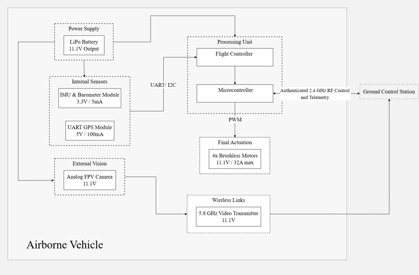
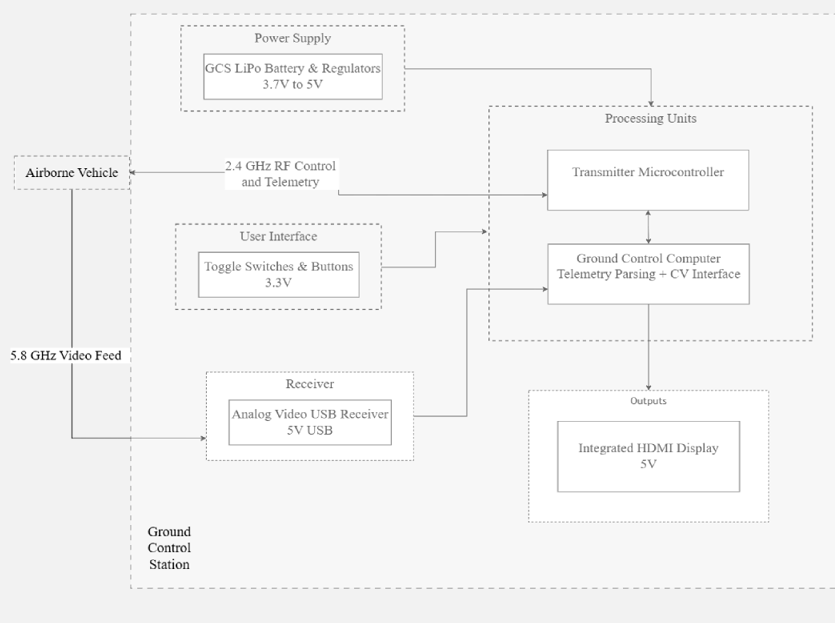

# ESP-BLAST: High-Speed Autonomous Interceptor UAV & Custom GCS

An ESP32-S3-based 60–80 km/h interceptor rocket drone paired with a custom handheld Ground Control Station (GCS), physically decoupled dual-band RF links, and off-board AI target-tracking HUD.

> **Final Year Project** | Department of Electrical Engineering, FAST NUCES Islamabad  
> **Team:** Shahzeb Niaz, Anas Bilal, Auon

---

## Key Engineering Highlights

* **Physical RF Channel Separation:**
  * **Channel A (Control & Telemetry):** Bidirectional 2.4 GHz ESP-NOW link with **HMAC-authenticated command framing** for low-latency flight control and telemetry.
  * **Channel B (Analog FPV Downlink):** Independent one-way 5.8 GHz analog video feed (`11.1V` VTX) received via USB OTG receiver so video bandwidth never degrades control link latency.
* **Ground-Side CV Isolation:** All telemetry parsing, real-time object detection, and custom HUD rendering run off-board on a Jetson-class Ground Control Computer driving an integrated 5V HDMI display—keeping the airborne ESP32-S3 flight controller dedicated to the real-time PID control loop.
* **Custom 4-Layer Flight Controller PCB:** Designed and verified for SMD assembly (JLCPCB), featuring dedicated internal power/ground planes (`In1_Cu`, `In2_Cu`), IMU/barometer (`3.3V` I2C/UART), GPS (`5V` UART), and PWM motor outputs (`11.1V` / `32A` max).
* **Aerodynamic Rocket Airframe:** Custom low-drag fuselage modeled in Autodesk Fusion for 60–80 km/h interception flight profiles, with 3D-printable `.stl` CAD files included in the repository.

---

## Subsystem & Firmware Architecture

| Airborne Vehicle | Ground Control Station |
| :---: | :---: |
|  |  |

### Flight Controller Execution Flow
* **Part 1 — Startup, Calibration & Sensor Acquisition:** Hardware initialization, oscillation-test auto-tuning mode, sensor readiness checks, and GPS/IMU validation ([`FC1.png`](docs/architecture/FC1.png)).
* **Part 2 — Command Authentication & Control Loop:** HMAC command verification, active-signal failsafe (*Safe Hover Mode*), PID motor mixing, and telemetry downlink ([`FC2.png`](docs/architecture/FC2.png)).

---

## Repository Contents

* [`/hardware/flight-controller-pcb`](./hardware/flight-controller-pcb) — 4-layer PCB Gerber archive, drill files, pick-and-place CSV, JLCPCB BOM, and verification report (`fyp-esp-fc-members-gerbers.zip`).
* [`/hardware/airframe-cad`](./hardware/airframe-cad) — Interactive 3D-printable `.stl` airframe files designed in Autodesk Fusion.
* [`/docs/architecture`](./docs/architecture) — High-resolution system block diagrams and firmware execution flowcharts.
* [`/docs/fyp-report`](./docs/fyp-report) — Complete Final Year Project documentation and analysis.
* [`/firmware`](./firmware) — ESP32-S3 flight controller and GCS transmitter C/C++ source code.
* [`/software`](./software) — Ground Control Computer telemetry parser and real-time object-detection HUD.

---

## Hardware & Tech Stack

| Domain | Technologies & Components |
| :--- | :--- |
| **Microcontrollers & Compute** | ESP32-S3 (Flight Controller & GCS Transceiver), Jetson-Class Ground Control Computer |
| **PCB & Mechanical CAD** | 4-Layer Custom SMD PCB (JLCPCB), Autodesk Fusion (`.stl` Airframe) |
| **RF & FPV Video** | 2.4 GHz ESP-NOW (HMAC Authenticated), 5.8 GHz Analog VTX (`11.1V`), USB Analog Video Receiver |
| **Sensors & Propulsion** | IMU & Barometer (`3.3V` I2C/UART), UART GPS (`5V`), 4× Brushless Motors (`11.1V` / `32A` max) |
| **Vision & Software** | Python, PyTorch, YOLO Object Detection, OpenCV, C/C++ |
